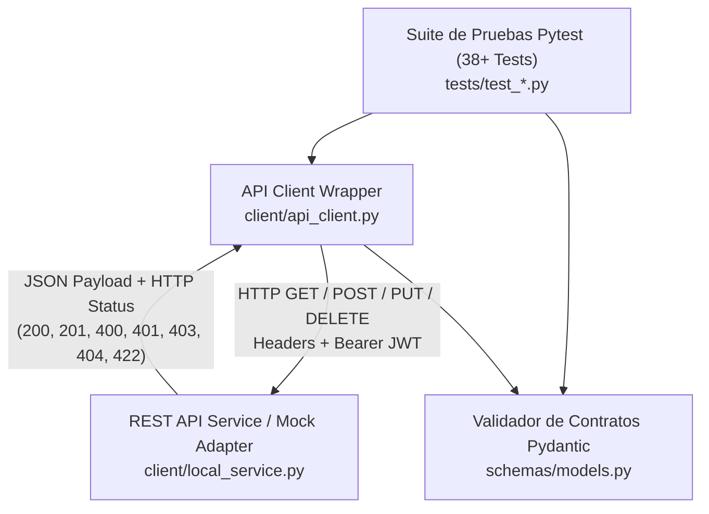

# REST API Test Automation & Contract Validation Framework


Un framework profesional de **pruebas automatizadas de Backend y APIs RESTful** construido en **Python**, **Pytest**, **Requests** y **Pydantic v2**. Diseñado para validar operaciones **CRUD**, autenticación mediante **tokens JWT**, contratos de esquemas JSON estrictos, tiempos de respuesta (SLA) y casos límite (*Boundary Value Analysis* & *Equivalence Partitioning*).

---

## 🏛️ Arquitectura del Framework



---

## 📂 Estructura del Proyecto

```text
api-testing-framework/
├── .github/
│   └── workflows/
│       └── api-tests.yml             # Pipeline CI/CD en GitHub Actions
├── client/
│   ├── __init__.py
│   ├── api_client.py                 # Cliente HTTP reutilizable con manejo de sesiones y JWT
│   └── local_service.py              # Adaptador REST determinista para pruebas rápidas en CI
├── schemas/
│   ├── __init__.py
│   └── models.py                     # Contratos JSON estrictos con Pydantic v2
├── tests/
│   ├── __init__.py
│   ├── conftest.py                   # Fixtures de autenticación, cliente y limpieza de estado
│   ├── test_auth_jwt.py              # Pruebas de login, tokens JWT, expiración y permisos (401/403)
│   ├── test_crud_endpoints.py        # Ciclo completo CRUD (GET, POST, PUT, DELETE) e idempotencia
│   ├── test_schema_contracts.py      # Validación de esquemas JSON y tipos de datos con Pydantic
│   └── test_edge_cases_bva.py        # Pruebas parametrizadas de valores límite, payloads corruptos y SQLi/XSS
├── .gitignore
├── pytest.ini                        # Configuración de marcadores y reportes
├── requirements.txt                  # Dependencias del proyecto
└── README.md                         # Documentación técnica
```

---

## 🧪 Cobertura de Escenarios Automatizados (38 Casos de Prueba)

| Módulo de Prueba | Archivo | Casos Cubiertos |
|---|---|---|
| **Autenticación & Seguridad JWT** | `tests/test_auth_jwt.py` | Emisión de token JWT (`200 OK`), credenciales inválidas (`401`), acceso sin token (`401`), token malformado/expirado (`401`), control de roles RBAC (`403 Forbidden`). |
| **Operaciones CRUD RESTful** | `tests/test_crud_endpoints.py` | Creación de recursos (`201 Created`), lectura paginada y por ID (`200 OK`), actualización total (`PUT 200`), eliminación (`DELETE 204`) y verificación de recurso inexistente (`404 Not Found`). |
| **Contratos JSON (Pydantic)** | `tests/test_schema_contracts.py` | Validación estricta de tipos, formatos ISO-8601, rangos numéricos, campos obligatorios y rechazo de propiedades no documentadas. |
| **Valores Límite (BVA) & Resiliencia** | `tests/test_edge_cases_bva.py` | 20+ pruebas parametrizadas con `@pytest.mark.parametrize`: límites de longitud, prioridades fuera de rango, payloads vacíos, inyección de caracteres especiales y SLA de latencia (`< 200ms`). |

---

## 🚀 Instalación y Ejecución Rápida

### 1. Clonar el repositorio e instalar dependencias
```bash
git clone https://github.com/jdabid/api-testing-framework.git
cd api-testing-framework
python3 -m venv .venv
source .venv/bin/activate
pip install -r requirements.txt
```

### 2. Ejecutar toda la suite de pruebas
```bash
pytest -v
```

### 3. Ejecutar por marcadores específicos
```bash
# Pruebas críticas de humo (Smoke Tests)
pytest -m smoke -v

# Pruebas de seguridad y autenticación JWT
pytest -m auth -v

# Pruebas de contratos de esquemas JSON
pytest -m contract -v

# Pruebas de casos límite (Boundary Value Analysis)
pytest -m bva -v
```

---

## 👨‍💻 Autor

**David Castro**  
*QA Automation Engineer / SDET Junior | Estudiante de Ingeniería de Sistemas (8vo Semestre)*  
- GitHub: [@jdabid](https://github.com/jdabid)
- YouTube: [@capyzendev](https://www.youtube.com/@capyzendev)

